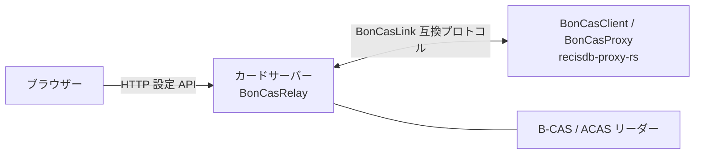

# BonCasRelay

BonCasRelay は B-CAS / ACAS カードを LAN 上のクライアントへ共有するサーバーです。Linux、macOS、Windows に対応します。

- Web 設定画面と任意のシステムトレイ
- APDU を判定し、B-CAS / ACAS リーダーへ自動振り分け
- カードリーダーごとの固定ポート
- 接続元 IP / CIDR 制限

## 構成



## インストールとビルド

Rust stable、Cargo、Python 3 が必要です。PC/SC 開発環境も用意してください。

- Debian / Ubuntu: `sudo apt install build-essential pkg-config libpcsclite-dev`
- macOS: Xcode Command Line Tools と PC/SC 環境
- Windows: Visual Studio Build Tools の C++ ワークロードと PC/SC 環境

```sh
cargo build --release --features tray
```

トレイなしの場合は `cargo build --release --no-default-features`。Linux のトレイは StatusNotifierItem (D-Bus) を使い、GTK や AppIndicator の開発パッケージは不要です。Debian / Ubuntu では基本依存の `libpcsclite-dev` と `pkg-config` を用意してください。GNOME ではトレイ表示に AppIndicator / KStatusNotifierItem 拡張が必要です。トレイ機能がない環境でもサーバーは動作し、警告を記録します。

## 使い方

```sh
./target/release/boncasrelay --allow 192.168.1.0/24
./target/release/boncasrelay --tray
./target/release/boncasrelay --list-readers
```

Web 設定画面の既定 URL は `http://127.0.0.1:6980/`。主なオプション:

| オプション | 説明 |
| --- | --- |
| `--config FILE` | INI を読み込む。UI 保存先にも指定ファイルを使う |
| `--listen IP` | TCP 待受アドレス |
| `--port PORT` | 自動振り分け用ポート |
| `--reader-port READER=PORT` | リーダー固定ポート。複数指定可 |
| `--bcas-reader NAME` / `--acas-reader NAME` | カード種別ごとのリーダー固定 |
| `--allow CIDR` | 接続元許可範囲。複数指定可 |
| `--web-listen IP:PORT` | Web UI 待受 |
| `--no-web` | Web UI 無効 |
| `--tray` | システムトレイを有効化 |
| `--list-readers` | リーダー一覧を表示して終了 |
| `--verbose` | APDU を含む詳細ログ |
| `--mock` | テスト専用。実カードを使わず固定の応答を返す |
| `--help` | オプション表示 |

## 設定

INI は UTF-8。BOM、空行、`;` / `#` コメントに対応。既存 INI 移行のため `[General]`、`[CardReader]`、`[CardPort]` の名称を維持します。

| セクション / キー | 既定値 | 説明 |
| --- | --- | --- |
| `[General] ListenAddress` | `0.0.0.0` | カード通信の待受 IP |
| `[General] ServerPort` | `6900` | 自動振り分けポート |
| `[General] Allow` | 空（全接続元） | 接続元 IP または CIDR。複数行可 |
| `[General] Verbose` | `false` | 詳細ログ |
| `[CardReader] BCAS` | 空 | B-CAS 用リーダー名または一意な部分文字列 |
| `[CardReader] ACAS` | 空 | ACAS 用リーダー名または一意な部分文字列 |
| `[CardPort] PORT` | なし | 固定ポートとリーダー名。例 `6902=Reader` |
| `[Web] Listen` | `127.0.0.1:6980` | Web UI 待受 |
| `[Web] Enabled` | `true` | Web UI の有効・無効 |
| `[Web] Token` | 空 | 外部待受で使う Bearer token |

設定場所: Linux `$XDG_CONFIG_HOME/boncasrelay/boncasrelay.ini`（未設定時 `~/.config/boncasrelay/boncasrelay.ini`）、macOS `~/Library/Application Support/BonCasRelay/boncasrelay.ini`、Windows `%APPDATA%\BonCasRelay\boncasrelay.ini`。

CLI 起動では暗黙の INI を読み込みません。`--config` 指定時はその INI を読み込みます。`--tray` は標準設定ファイルを読み込みます。CLI 指定は INI より優先されます。Web UI の保存は実行中に適用し、設定ファイルへ原子的に保存します。起動時の CLI 上書きは次回起動にも適用されます。外部 Web 待受では token が未設定なら生成して設定ファイルに保存します。

## 常駐・自動起動

- systemd: `contrib/systemd/boncasrelay.service` をユーザー unit として配置し、バイナリと設定パスを調整。
- macOS: `contrib/launchd/io.github.stuayu.boncasrelay.plist` を `~/Library/LaunchAgents/` に配置し、バイナリパスを調整。
- Linux デスクトップ: `contrib/autostart/boncasrelay.desktop` を `~/.config/autostart/` に配置。
- Windows: `Win+R` → `shell:startup` を開き、`boncasrelay.exe --tray` のショートカットを配置。

## セキュリティ

BonCasLink 互換プロトコルは平文・無認証です。TCP 待受は信頼できる LAN に限定し、`Allow`、ファイアウォール、VPN を設定してください。Web UI はループバック待受が既定です。外部 IP で待ち受ける場合は token が必須です。Web token はカード通信プロトコルを保護しません。HTTP 自体も平文です。

## 互換性

BonCasClient、BonCasProxy、recisdb-proxy-rs の BonCasLink クライアントから接続できます。BonCasLink 互換プロトコルを拡張せずにそのまま実装しています。INI セクション・キー名も既存設定との互換性のため維持しています。

## 開発

```sh
cargo fmt --all -- --check
cargo clippy --all-targets --all-features -- -D warnings
cargo test --all-features
cargo build --release --features tray
python3 tests/integration.py target/release/boncasrelay
python3 tests/server_limits.py target/release/boncasrelay
```

構成: `crates/boncasrelay-core`（判定、ルーティング、設定、状態）、`crates/boncasrelay`（TCP サーバー、Web UI、トレイ）、`tests/`（プロセス統合試験）、`assets/`（アイコン生成物と生成スクリプト）、`contrib/`（設定・常駐例）、`docs/`（設計と API）。

## ライセンスと謝辞

GPL-3.0-or-later。詳細は [LICENSE](LICENSE) を参照してください。

BonCasLink 互換プロトコルを生み出し、長年にわたって維持・改良してきた DTV コミュニティの皆さまに感謝します。
